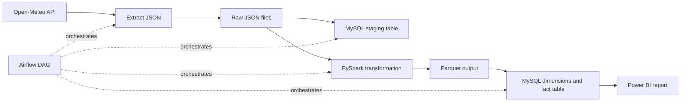

# Automated Weather Data Pipeline

An end-to-end data engineering portfolio project that collects current weather data, orchestrates the workflow with Apache Airflow, transforms records with PySpark, and loads them into a MySQL star schema for Power BI.

## Architecture



The DAG runs once per day. It reads current weather for one configured coordinate, preserves each raw JSON response, writes an idempotent copy to MySQL staging, transforms the raw files to Parquet, and upserts the processed records into the warehouse.

## Technology

- Python and SQL
- Apache Airflow 2.7.2
- Apache Spark / PySpark 3.5.1
- MySQL 8
- Docker Compose
- Power BI

## Repository layout

```text
.
├── dags/                    # Airflow workflow
├── scripts/                 # Extraction, staging, Spark, and warehouse code
├── sql/                     # MySQL staging and star-schema definitions
├── raw/                     # Sample and newly extracted JSON files
├── processed/               # Parquet output generated by Spark
├── Dockerfile               # Airflow image with Java and Python dependencies
├── docker-compose.yaml      # Local Airflow and MySQL services
├── project.pbix             # Power BI report
└── .env.example             # Local configuration template
```

## Run locally

Requirements: Docker Desktop with Docker Compose and an internet connection for the Open-Meteo API.

1. Clone the repository and open its directory:

   ```bash
   git clone https://github.com/aymanlahlou12/data-pipeline-project.git
   cd data-pipeline-project
   ```

2. Copy `.env.example` to `.env` and replace both MySQL password values with local passwords. In PowerShell, run `Copy-Item .env.example .env`; on macOS or Linux, run `cp .env.example .env`.
3. Build and start the services:

   ```bash
   docker compose up -d --build
   ```

4. Open Airflow at [http://localhost:8080](http://localhost:8080). The standalone Airflow service creates an administrator account on first startup; find its generated password in `docker compose logs airflow`.
5. Unpause `weather_automated_pipeline` in the Airflow interface and trigger it.
6. Open `project.pbix` in Power BI and connect to MySQL at `127.0.0.1`, port `MYSQL_HOST_PORT` from `.env`, database `weather_etl`, user `weather_app`, and the `MYSQL_PASSWORD` value from `.env`.

The MySQL tables are created the first time the MySQL volume is initialized. If you change the SQL schema later, apply a migration or recreate the database volume deliberately; Docker does not rerun initialization scripts against an existing database.

To stop the services while preserving data:

```bash
docker compose down
```

To delete the local Airflow and MySQL data as well:

```bash
docker compose down -v
```

## Data model

- `staging_weather` stores one row for each distinct reading, and repeated loads update that row.
- `dim_location` stores distinct coordinates.
- `dim_time` stores distinct reading timestamps.
- `fact_weather` stores temperature and wind speed by location and time. Repeated runs update an existing fact rather than creating duplicates.

Example warehouse query:

```sql
SELECT
    location.latitude,
    location.longitude,
    reading_time.reading_time,
    weather.temperature,
    weather.windspeed
FROM fact_weather AS weather
JOIN dim_location AS location USING (location_id)
JOIN dim_time AS reading_time USING (time_id)
ORDER BY reading_time.reading_time DESC;
```

## Scope

This is a local portfolio demonstration, not a production deployment. It currently collects one current-weather reading per scheduled run for one coordinate. Airflow runs in standalone mode, and the API coordinates and schedule are defined in the source code.
